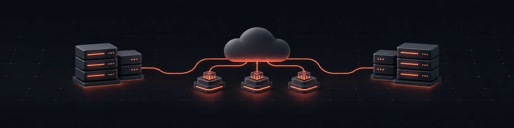

# Rodrigo Ureña Castillo

**Technology Enthusiast**

I’m interested in cloud computing, especially **Oracle Cloud Infrastructure (OCI)**, and in building AI agents with **Oracle AI Agent Studio** and **Oracle Fusion Cloud**.

[LinkedIn](https://www.linkedin.com/in/rodrigo-ure%C3%B1a-castillo-6116b5238/) · [Email](mailto:rodrigourenacastillo@gmail.com)

## Featured projects

### [SORTH-AI](https://github.com/RodrigoUC/SORTH-AI)

I developed this desktop application as a student assistant at Universidad Nacional. It generates academic schedules from configurable constraints and lets staff review, adjust, import, and export schedule data.

**Stack** · Python, PyQt6, SQLite, pandas

### Hobbing · Private project

I worked on the Android app for exchanging hobbies and skills. The app uses Jetpack Compose and Material 3 for the interface and Clean Architecture to separate presentation, domain, and data.

**Stack** · Kotlin, Jetpack Compose, Material 3, Clean Architecture

### Other projects

- [Nexo IA](https://github.com/RodrigoUC/framework_ia) — Streamlit platform for exploratory data analysis, clustering, classification, and regression.
- [Mini Message Broker](https://github.com/RodrigoUC/Mini-message-broker) — Educational C project exploring TCP sockets, concurrency, and message persistence.

## Technical stack

<!-- Keep badge images in assets/stack and include the tool name as alt text. -->

### Cloud & AI agents

### Languages

### Frameworks & UI

### Automation & developer tools

## Certifications

Oracle Cloud Infrastructure · Microsoft Azure · Oracle Fusion AI Agent Studio
